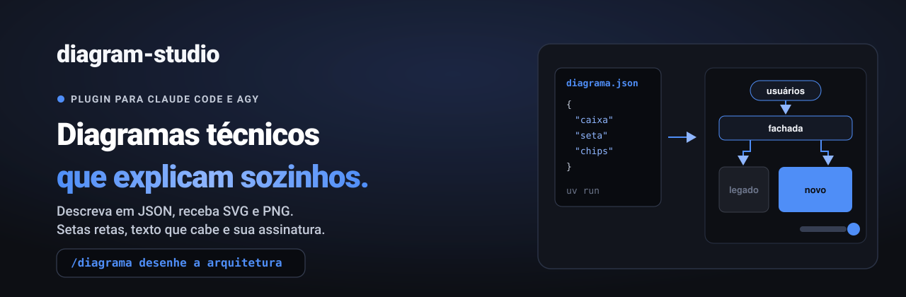
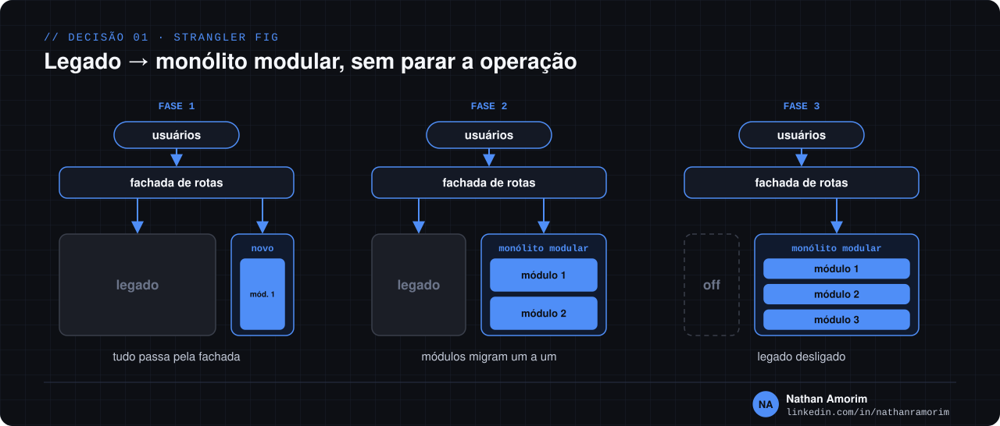
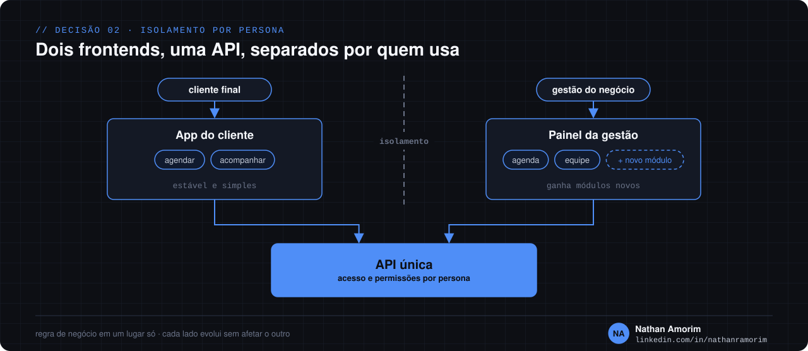

<p align="center">
  
</p>

<p align="center">
  <a href="https://github.com/nathanramorim/diagram-studio/releases"></a>
  
  
  
  
</p>

<h3 align="center">Descreva em JSON, receba SVG e PNG.<br>Setas retas, texto que cabe e sua assinatura.</h3>

---

## O que é

O **diagram-studio** desenha diagramas técnicos com cara de material profissional: fundo escuro com grade, setas em ângulo reto, texto que sempre cabe na caixa e a sua assinatura no canto, com avatar do GitHub e link.

Você pede em português ("desenha a migração do legado em três fases"). A IA monta um JSON curto, mostra o plano e só gera depois do seu "sim". Sai um **SVG** para README e documentação e um **PNG** para slides e LinkedIn.

## Exemplos

<p align="center"></p>

<p align="center"></p>

## Por que usar

| | |
|---|---|
| 🎯 **Uma mensagem por imagem** | Cada diagrama conta uma ideia, com título em uma frase. |
| 📐 **Sempre alinhado** | Grade de 8 px, setas em ângulo reto e texto que se ajusta ao tamanho da caixa. |
| ✍️ **Com a sua assinatura** | Avatar do GitHub, nome e link no rodapé. Configurável, ou desligável. |
| 🔁 **Padrão em todo lugar** | O mesmo visual em README, ADR, proposta e post. |
| 🛡️ **Sem invenção** | Não cria componentes, números nem nomes de cliente. Anonimiza quando precisa. |

## Antes de começar

- **Claude Code** ou **agy (Antigravity)**.
- **[uv](https://docs.astral.sh/uv/)** instalado. Ele cuida do Python e das dependências sozinho.

## Instalação

### No Claude Code

```
/plugin marketplace add nathanramorim/diagram-studio
/plugin install diagram-studio@diagram-studio
```

### No agy (Antigravity)

```bash
git clone https://github.com/nathanramorim/diagram-studio.git
mkdir -p .agents/skills
cp -R diagram-studio/skills/diagrama-studio .agents/skills/
cp -R diagram-studio/scripts diagram-studio/config diagram-studio/exemplos .agents/skills/diagrama-studio/
```

## Como usar

| Claude Code | agy |
|---|---|
| `/diagrama desenhe a arquitetura deste projeto` | "Desenhe a arquitetura deste projeto com o diagrama-studio" |

Ou rode o script direto com um JSON seu:

```bash
uv run scripts/diagrama.py exemplos/personas.json --saida docs/img/personas
```

### Use a sua assinatura

Crie `~/.config/diagram-studio/assinatura.json`:

```json
{
  "nome": "Seu Nome",
  "github": "seu-usuario",
  "link": "https://www.linkedin.com/in/seu-usuario",
  "avatar_arquivo": ""
}
```

Com `avatar_arquivo` vazio, o avatar é baixado uma vez de `github.com/seu-usuario.png`. Para usar uma foto sua, coloque o caminho dela. Em qualquer caso a imagem fica embutida no SVG. Para outra paleta, crie `estilo.json` na mesma pasta (veja `config/estilo.json`).

## Segurança e privacidade

- Roda na sua máquina. Rede só para o avatar do GitHub (uma vez) e para o uv baixar a dependência `resvg-py` (que gera o PNG) na primeira execução.
- Nada do seu projeto é enviado para fora pelo script.
- A skill orienta a anonimizar clientes e não expor regras de negócio nos desenhos.

## Versões

| Versão | Novidades |
|---|---|
| 0.1.0 | Primeira versão: caixas, chips, setas com âncoras, divisórias, assinatura com avatar, saída SVG e PNG. |

## Licença

[MIT](LICENSE)
